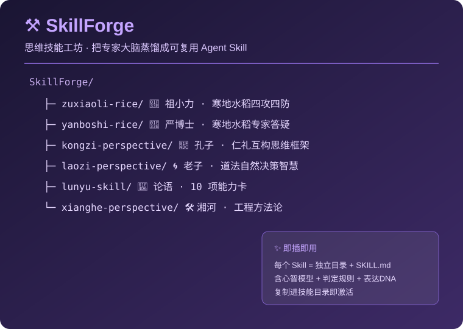

# ⚒️ SkillForge

> 思维技能工坊 —— 把「专家的大脑」蒸馏成可复用的 Agent Skill
> 面向 AI Agent / 大模型知识库，将行业专家、经典思想、工程师方法论封装成开箱即用的技能包。

[English](README.en.md) · [Changelog](CHANGELOG.md)

---

<p align="center">
  
</p>

## 🌟 为什么是 SkillForge？

一个领域的真正价值，藏在**专家的思维方式**里——不是零散的知识点，而是"遇到问题怎么想、先查什么、按什么规则判断、怎么给结论"的整套方法论。

**SkillForge 就是把这种思维方式"锻造"成可执行技能的地方**：通过蒸馏流水线，把专家实录、经典典籍、工程实践提炼成结构化的 `SKILL.md` 技能包，让任何 AI Agent 加载即用、即插即战。

---

## ✨ 特色与亮点

- **专家思维蒸馏**：每个 Skill 不只是"知识库"，更是"思维操作系统"——含核心心智模型、判定规则、表达 DNA、诚实边界。
- **即插即用**：每个 Skill 是独立目录 + `SKILL.md`，符合主流 Agent Skill 规范，复制进技能目录即可激活。
- **领域多元**：从**寒地水稻专家**（祖小力/严博士）到**国学思想**（孔子/老子/论语），再到**工程师方法论**（湘河），一套技能库覆盖农业 / 哲学 / 工程。
- **开箱即测**：每个 Skill 自带触发词、判定规则、应用边界与回滚思路，可直接接入问答、排障、决策场景。
- **持续锻造**：随蒸馏流水线迭代持续新增技能包（水稻、国学、工程方法论持续扩展中）。

---

## 📦 技能包清单

| Skill | 领域 | 核心能力 |
|---|---|---|
| **zuxiaoli-rice** | 农业 | 祖小力 · 寒地水稻四攻四防实战方法论 |
| **yanboshi-rice** | 农业 | 严博士 · 寒地水稻专家答疑与种植决策 |
| **kongzi-perspective** | 国学 | 孔子视角 · 仁礼互构、忠恕一贯的思维框架 |
| **laozi-perspective** | 国学 | 老子视角 · 道法自然、反者道之动的决策智慧 |
| **lunyu-skill** | 国学 | 论语方法论 · 孔子修身与决策的 10 项能力卡 |
| **xianghe-perspective** | 工程 | 湘河思维 · 服务器运维 / AI 部署 / 知识库建设方法论 |

---

## 🚀 快速使用

### 方式一：作为 Agent Skill 加载

```bash
git clone https://github.com/15143221112/SkillForge.git
# 将需要的 skill 目录复制到你的 Agent 技能目录
cp -r SkillForge/zuxiaoli-rice <你的技能目录>/
```

加载后即可触发，例如：
- 输入「水稻分蘖期怎么施肥」→ 激活 zuxiaoli-rice / yanboshi-rice
- 输入「用孔子的视角看这个决策」→ 激活 kongzi-perspective

### 方式二：作为方法论参考研读

直接阅读各 Skill 的 `SKILL.md`，学习专家如何拆解问题、设定判定规则、给出结论。

---

## 📁 目录结构

```
SkillForge/
├── zuxiaoli-rice/
│   ├── SKILL.md               # 技能定义 + 心智模型
│   └── references/            # 调研素材
├── yanboshi-rice/
│   └── SKILL.md
├── kongzi-perspective/
├── laozi-perspective/
├── lunyu-skill/
├── xianghe-perspective/
├── README.md
├── LICENSE
└── CHANGELOG.md
```

---

## 📄 协议

[MIT](LICENSE) © 2026 SkillForge contributors
